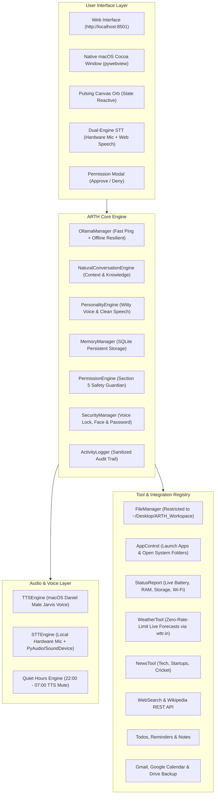

# ARTH: Automated Response to Human Intent

<div align="center">

[](https://www.python.org/)
[](https://apple.com)
[](https://ollama.com)
[](https://apple.com)
[](https://docs.pytest.org/)
[](LICENSE)

**A Jarvis-grade personal AI assistant for macOS, designed to automate human intent with privacy, witty intelligence, and speed.**

</div>

---

## 🌟 Executive Summary

**ARTH (Automated Response to Human Intent)** is a private, local-first artificial intelligence assistant engineered specifically for macOS. Built with a unified architecture, ARTH combines:

- **A Single Authoritative Personality:** Speaks like a sharp, loyal, witty friend. Calls the user **Boss**.
- **100% Local Inference:** Powered by Ollama (`qwen2.5:0.5b`, `gemma4:12b`, `smollm2:135m`) with zero corporate telemetry or cloud dependencies.
- **Single Male Jarvis Voice:** Driven by native macOS speech synthesis (**Daniel** British male voice) with dual-engine speech recognition (Mac hardware mic + browser Web Speech).
- **Futuristic Jarvis Glowing Orb GUI:** High-performance dark cyberpunk web and native desktop interface with a pulsing HTML5 Canvas arc reactor orb reflecting Idle, Thinking, Listening, Speaking, and Approval Needed states.
- **Military-Grade Safety & Security:** 3-tier authorization gate for risky actions (Spoken "Yes" + Face Blink Check + Typed Master Password), voice lock speaker verification, instant lockdown freeze, and strict sandbox file boundaries.

---

## 🏛️ System Architecture



---

## 🛠️ Complete Tech Stack

| Component | Technology | Description |
| :--- | :--- | :--- |
| **Language & Runtime** | Python 3.10+ / 3.13 | Core logic, multithreading, and async task orchestration |
| **Brain & Local LLM** | [Ollama](https://ollama.com) | Local model inference (`qwen2.5:0.5b`, `gemma4:12b`, `smollm2:135m`) |
| **Reasoning Engine** | `NaturalConversationEngine` | Context-aware dialogue memory, Wikipedia REST API & DuckDuckGo Instant Answers |
| **Speech Synthesis (TTS)** | macOS `say -v Daniel` | Single British male voice with zero network latency |
| **Speech Recognition (STT)**| `sounddevice` + `speech_recognition` | Hardware microphone recording + Browser Web Speech API fallback |
| **Desktop GUI** | `pywebview` | Native macOS Cocoa WebKit desktop window |
| **Web GUI** | Vanilla HTML5 / CSS3 / ES6 / Canvas | Futuristic dark cyberpunk interface with animated glowing orb |
| **Database & Memory** | SQLite3 | Local persistent key-value memory & observed habits |
| **Security & Auth** | SHA-256 + Local Biometric Simulation | Voice verification, anti-spoof blink challenge, master password, emergency lockdown |
| **Testing Suite** | `pytest` | 70 automated unit, integration, and security tests |

---

## ⚡ Key Capabilities & Features

### 1. Natural Contextual Dialogue
- **Follow-Up Memory:** Seamlessly understands follow-ups like *"which storage are you saying about"* after a status check, providing exact disk gigabytes.
- **Direct Queries:** Replies in `<1ms` for time, date, greetings, and system diagnostics.
- **Conversational Fluency:** Discusses programming, airplanes, food recommendations, and tech humor in concise 1–3 sentence spoken outputs.
- **Kannada & Multilingual Banter:** Native greeting support (*"kannada gothaa"* $\to$ *"Haudhu Boss! Nanage Kannada chennagi gothu"*).

### 2. Desktop & File Automation (Safety-Bound)
- **Natural App Opening:** *"can you open the calculator"*, *"open spotify"*, *"open terminal"*.
- **Finder Folders:** *"open my desktop please"*, *"open downloads"*, *"open workspace"*.
- **Workspace File Management:** Strictly sandboxed to `~/Desktop/ARTH_Workspace`. Can find, open, move, rename, and organize files by category (`Documents/`, `Code/`, `Images/`, `Data/`). Never overwrites; moves to Trash instead of deleting.

### 3. Military-Grade Security & Safety (Sections 5, 12, 30, 31)
- **Voice Lock:** Unrecognized voices receive a polite warning and are subsequently ignored.
- **3-Tier Gate for Risky Actions:** Permanent wipes, remote shutdowns, or mass renames require Spoken "Yes" + Face Blink Check + Master Typed Password.
- **Instant Lockdown Freeze:** Typing or speaking *"ARTH, lockdown"* freezes all tools and interfaces immediately until unlocked with dual credentials.

---

## 🚀 Complete Step-by-Step Build & Setup Guide

### 1. Prerequisites
- **macOS:** macOS Monterey, Ventura, Sonoma, or Sequoia.
- **Python:** Python 3.10, 3.11, 3.12, or 3.13 (`python3 --version`).
- **Ollama:** Download and install from [ollama.com](https://ollama.com).

### 2. Clone the Repository
```bash
git clone https://github.com/algoreetham/ARTH-Automated-Response-To-Human-Intent.git
cd ARTH-Automated-Response-To-Human-Intent
```

### 3. Create Virtual Environment & Install Dependencies
```bash
python3 -m venv .venv
source .venv/bin/activate
pip install -r requirements.txt
```

### 4. Setup Ollama Model
Start the Ollama daemon (if not already running):
```bash
ollama serve
```

In a new terminal window, pull the recommended lightweight conversational model:
```bash
ollama pull qwen2.5:0.5b
```
*(Optional: For higher-parameter setups, you can also pull `ollama pull gemma4:12b` or `ollama pull smollm2:135m`)*.

### 5. Configure Settings
Copy the example environment configuration:
```bash
cp .env.example .env
```
Inspect or customize `config.yaml` to specify your preferred user name, TTS voice, quiet hours, and sandbox folder.

---

## 💻 Running ARTH

### Mode 1: Futuristic Web Interface (Recommended)
Launches the responsive dark cyberpunk interface on local port `8501`:
```bash
python3 main.py --web
```
Open your browser at **[http://localhost:8501/](http://localhost:8501/)**.

### Mode 2: Native macOS Desktop Application
Launches ARTH inside a dedicated Cocoa / WebKit desktop window with pywebview:
```bash
python3 main.py --gui
```

### Mode 3: Interactive Terminal Chat
Run directly in your command line:
```bash
python3 main.py --chat
```

### Mode 4: Verification & Readiness Check
Check local Ollama readiness and exit without launching GUI:
```bash
python3 main.py --check-only
```

---

## 🧪 Running the Test Suite

ARTH includes an exhaustive automated test suite covering all phases of functionality (Brain, Voice, Memory, Permissions, Security, Files, Apps, Gmail, Calendar, and Lockdown):

```bash
pytest tests/ -v
```

**Test Results:**
```
======================== 70 passed, 1 warning in 12.23s ========================
```

---

## 🗣️ Example Voice & Text Commands

| Category | Example Command | Expected Behavior |
| :--- | :--- | :--- |
| **System Status** | *"what's my system status"* | Reports battery %, storage free, and Wi-Fi state. |
| **Context Follow-up** | *"which storage are you saying about"* | Explains Macintosh HD capacity and free space. |
| **Time & Date** | *"can you say me what's the time"* | Returns exact current time (*"It is currently 1:28 PM, Boss."*). |
| **App Control** | *"can you open the calculator"* | Automatically launches Calculator on macOS. |
| **Folder View** | *"open my desktop please"* | Opens Desktop directory in Finder. |
| **File Sandbox** | *"open one file"* / *"open notes.txt"* | Opens target document in `~/Desktop/ARTH_Workspace`. |
| **File Organize** | *"organize workspace files"* | Categorizes files into `Documents/`, `Code/`, `Images/` with your permission. |
| **Weather** | *"what's the weather in Bengaluru"* | Provides live temperature, humidity, and sky condition. |
| **Humor** | *"tell me a joke"* | Cracks witty programmer humor. |
| **Memory** | *"remember this: my favorite coffee is filter coffee"* | Saves to local SQLite database. |
| **Audit** | *"what did you do today"* | Summarizes all approved and denied actions from activity log. |
| **Security Freeze**| *"ARTH, lockdown"* | Freezes all commands until unlocked with password + face check. |

---

## 🛡️ Privacy & Safety Invariants

1. **Zero Cloud Leaks:** All conversational reasoning, storage checks, and memory persist exclusively on your Mac.
2. **Never Overwrites:** Files are never overwritten without explicit prompt.
3. **Trash, Never Delete:** Permanent `rm` commands are forbidden; files are safely moved to `.Trash`.
4. **Quiet Hours:** Between `22:00` and `07:00`, all speech synthesis and audio chimes are automatically silenced.

---

## 👨‍💻 Author & Maintainer

- **Developer:** [Preetham Singh SP (algoreetham)](https://github.com/algoreetham)
- **Repository:** [ARTH-Automated-Response-To-Human-Intent](https://github.com/algoreetham/ARTH-Automated-Response-To-Human-Intent)
- **License:** MIT License
